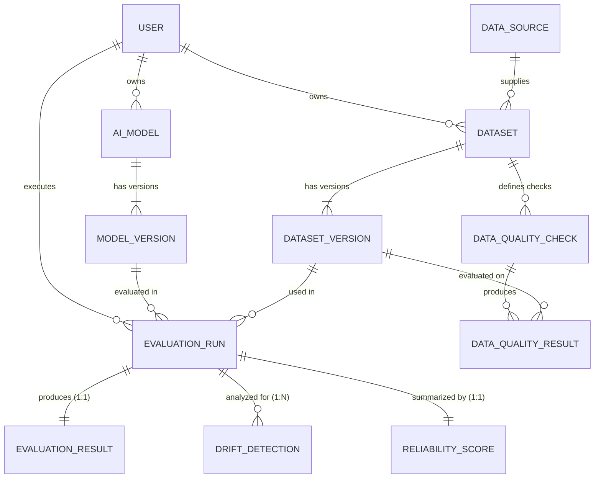

# Entity-Relationship (ER) Diagram & Structural Mapping

## 1. Official ER Diagram (Mermaid)

The following diagram represents the approved relational structure submitted in `279_307.pdf`.

---

## 2. Table Cardinalities & Relationship Catalog

| Parent Entity | Relationship | Child Entity | Foreign Key Column | Cardinality | Cascade Action |
|---|---|---|---|---|---|
| `user` | owns | `dataset` | `dataset.owner_id` | 1 : N | `ON DELETE RESTRICT` |
| `user` | owns | `ai_model` | `ai_model.owner_id` | 1 : N | `ON DELETE RESTRICT` |
| `user` | executes | `evaluation_run` | `evaluation_run.executed_by` | 1 : N | `ON DELETE RESTRICT` |
| `data_source` | supplies | `dataset` | `dataset.source_id` | 1 : N | `ON DELETE RESTRICT` |
| `dataset` | versions | `dataset_version` | `dataset_version.dataset_id` | 1 : N | `ON DELETE CASCADE` |
| `dataset` | defines | `data_quality_check` | `data_quality_check.dataset_id` | 1 : N | `ON DELETE CASCADE` |
| `data_quality_check`| produces | `data_quality_result` | `data_quality_result.quality_check_id` | 1 : N | `ON DELETE CASCADE` |
| `dataset_version` | tested by | `data_quality_result` | `data_quality_result.dataset_version_id`| 1 : N | `ON DELETE CASCADE` |
| `ai_model` | versions | `model_version` | `model_version.model_id` | 1 : N | `ON DELETE CASCADE` |
| `model_version` | participates | `evaluation_run` | `evaluation_run.model_version_id` | 1 : N | `ON DELETE CASCADE` |
| `dataset_version` | participates | `evaluation_run` | `evaluation_run.dataset_version_id` | 1 : N | `ON DELETE CASCADE` |
| `evaluation_run` | outputs | `evaluation_result` | `evaluation_result.evaluation_id` | 1 : 1 (UNIQUE) | `ON DELETE CASCADE` |
| `evaluation_run` | measures | `drift_detection` | `drift_detection.evaluation_id` | 1 : N | `ON DELETE CASCADE` |
| `evaluation_run` | scores | `reliability_score` | `reliability_score.evaluation_id` | 1 : 1 (UNIQUE) | `ON DELETE CASCADE` |

---

## 3. Core Evaluation Pathway

The operational heart of the system is the convergence of model versioning and data versioning into an evaluation run:

$$\text{MODEL\_VERSION} + \text{DATASET\_VERSION} \longrightarrow \text{EVALUATION\_RUN}$$

From this single execution, three distinct analytical perspectives branch out:
1. **Model Performance Perspective:** Captured by `EVALUATION_RESULT` (Accuracy, Precision, Recall, F1-score).
2. **Distribution Shift Perspective:** Captured by `DRIFT_DETECTION` (Population Stability Index against reference baseline).
3. **Consolidated Governance Perspective:** Captured by `RELIABILITY_SCORE` (Weighted index combining data quality, performance, and drift).
